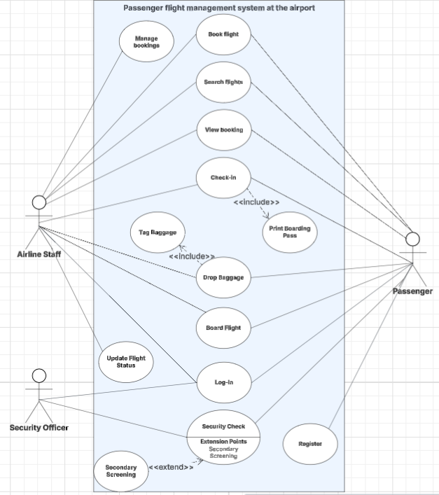
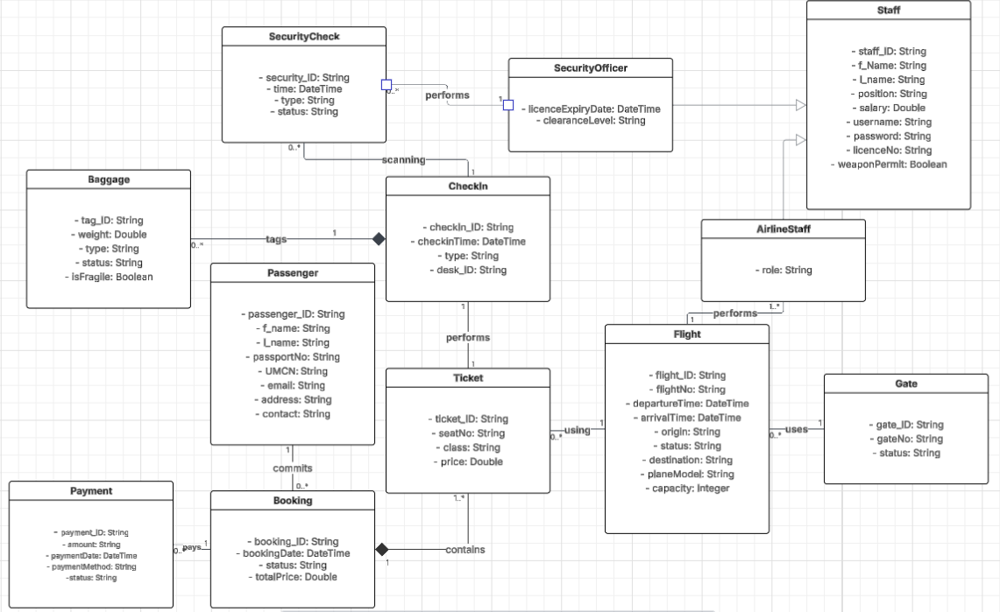
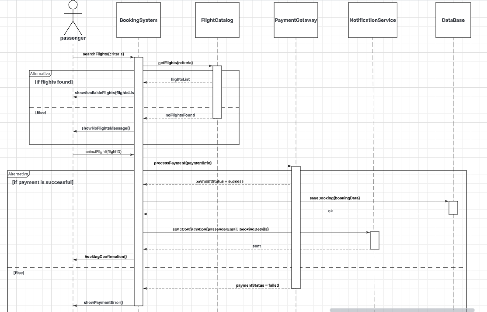

# flight-managment-system
Airport ERP system built with C# WPF and MSSQL.

A desktop application for managing airport operations, developed as a university project (awarded the highest grade). The system enables flight tracking, passenger management, ticket reservations, and visual data representation through a modern user interface.

## 🛠️ Technologies
* **Backend & Logic:** C# (Object-Oriented Programming)
* **Frontend (UI):** WPF (Windows Presentation Foundation)
* **Database:** MS SQL Server (Relational Database, T-SQL)
* **Architecture:** 3-Tier Architecture (UI, BLL, DAL)

## 📊 System Design & UML Architecture
Prior to coding, the system was thoroughly modeled using UML standards to ensure architectural robustness and scalability.

### 1. Use Case Diagram
Displays the main actors (Employees, Passengers) and their interactions with the system's modules.

### 2. Class Diagram
Represents the static structure of the system, including associations, compositions, and generalizations between key entities.

### 3. Sequence Diagram
Illustrates the dynamic interaction and flow of messages over time during the flight reservation process.

## 🗄️ Database (MSSQL)
The database is designed in the Third Normal Form (3NF) with strict referential integrity rules (Foreign Keys, Cascade Delete). 

**How to run the database locally:**
1. Open SQL Server Management Studio (SSMS).
2. Execute the `AirportSystemScript.sql` (DDL) script to generate the tables and relations.
3. Execute the `AirportSystem.sql` (DML) script to insert initial/test data into the system.

## 🚀 How to Run the Application
1. Clone this repository to your local machine.
2. Ensure the database is configured (see the steps above).
3. Open the `AirportProject.sln` solution file in Visual Studio.
4. In the `Connection.cs` (or `App.config`) file, verify and update the *Connection String* to match your local SQL Server instance.
5. Build and run the project (F5).
